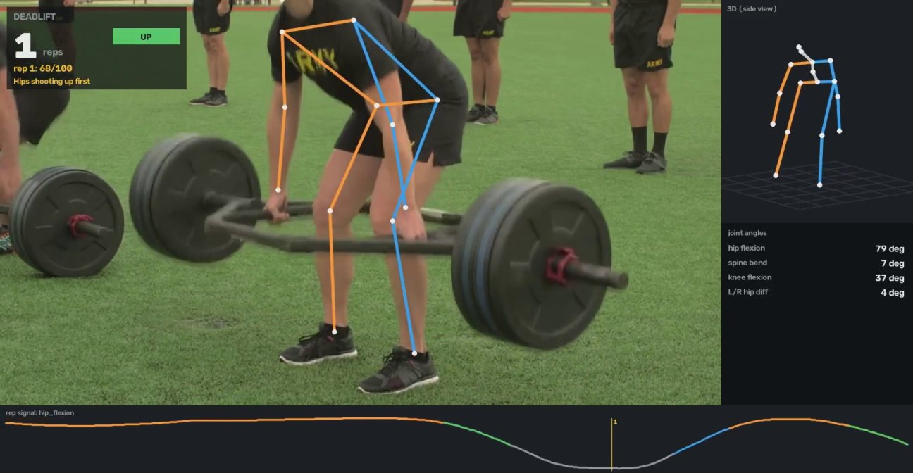

# FormFlow

**Markerless 3D human pose and biomechanics coach.** Point a laptop or phone camera at someone
exercising. FormFlow rebuilds their 3D skeleton live, counts reps, measures joint angles, and names the
exact form fault on every rep ("knees caving in", "rounded back", "hips sagging") with on-screen and
spoken cues. It needs no markers, depth sensor or calibration, just one ordinary camera.



| | Result | How it was measured |
|---|---|---|
| **Joint angles vs motion capture** | **8.2°** mean error offline, **9.2°** live (trunk 2.7°, hip 4.5°, knee 7.2°) | Human3.6M S9 + S11, 567k frames vs Vicon mocap |
| **Rep counting** | **64%** of videos within one rep, normalised error **0.29**, not trained on the dataset | RepCount-A test split, 152 real videos |
| | squats **83%**, jumping jacks **85%**, sit-ups **80%** within one rep | |
| **Live speed** | **53 fps** (21 ms/frame) on a laptop RTX 3050, **9 fps** on a CPU | full pipeline: detect, 2D, 3D, angles, rules |
| **Framing robustness** | 5.7° vs 11.9° for the standard normalisation when the athlete is half the size in frame | Human3.6M, 2D input zoomed 0.5x |

Everything above is reproduced by `formflow bench ...`. Raw output: [benchmarks/results/BENCHMARK.md](benchmarks/results/BENCHMARK.md).
Annotated example videos of real people: [samples/](samples/).

---

## Contents

1. [What is built here (and what is not)](#what-is-built-here-and-what-is-not)
2. [Quick start: one command](#quick-start-one-command)
3. [Step by step](#step-by-step)
4. [Benchmarks](#benchmarks)
5. [How it works](#how-it-works)
6. [Exercises and form rules](#exercises-and-form-rules)
7. [Command line](#command-line)
8. [Repository layout](#repository-layout)
9. [Testing and CI](#testing-and-ci)
10. [Configuration](#configuration)
11. [Troubleshooting](#troubleshooting)
12. [Limitations and next steps](#limitations-and-next-steps)

---

## What is built here (and what is not)

| Part | Built here | Off the shelf |
|---|---|---|
| 2D keypoints | ONNX Runtime pipeline: YOLOX letterboxing, RTMPose top-down affine crop, **SimCC decoding**, a **tracker** that derives the next box from the keypoints and re-detects asynchronously on a background thread | YOLOX and RTMPose-m weights (OpenMMLab, Apache-2.0) |
| **2D → 3D lifting** | **MotionBERT DSTformer port** (fused attention, checkpoint-compatible, equal to the original to 4e-6), zoom-invariant input normalisation, flip test-time augmentation, overlapping Hann-blended clips offline, a **causal streaming lifter** for live use | MotionBERT checkpoints fine-tuned on Human3.6M (Apache-2.0) |
| **Temporal signal processing** | confidence-aware **One Euro filter**, 35 joint metrics (flexion, valgus, KASR, trunk / spine angles, symmetry, ...), a **gravity estimate** from the standing pose (tilted phones), a **rep state machine** with adaptive range and lockout detection, periodicity-based **auto mode** | — |
| **Biomechanics rule engine** | YAML exercise definitions (11 exercises + auto, 45 rules), limit / tempo / ratio rules with 11 aggregates, per-rep score, worst side, live joint highlighting, a cue manager that doesn't nag | — |
| Product | web app (live camera over WebSocket, video upload, sessions), desktop window, annotated videos, HTML reports, one-command installer, Docker | FastAPI, OpenCV, FFmpeg |
| Evaluation | H36M joint-angle error harness, RepCount-A rep-count harness, live latency benchmark, synthetic athlete with injectable faults | Human3.6M, RepCount-A |

The 3D pose comes from learned human-body priors (MotionBERT, trained on motion capture), not from
depth maps or camera geometry.

---

## Quick start: one command

You need Python 3.10–3.12. An NVIDIA GPU makes live coaching smooth but is not required.

```bash
git clone https://github.com/AshishIsaac/FormFlow.git
cd FormFlow
python run.py          # or: double-click start.bat (Windows) · bash start.sh (macOS/Linux)
```

The first run opens a setup window. It creates a private `.venv`, installs PyTorch and ONNX Runtime
(CUDA builds with an NVIDIA GPU, otherwise CPU), FormFlow, and the three models (YOLOX, RTMPose-m,
MotionBERT-Lite: about 210 MB with a GPU, 135 MB without). It then checks everything on a synthetic athlete
plus a real model forward pass and opens the web app at <http://localhost:8780>. Later runs start
straight away. An interrupted setup resumes where it stopped.

```bash
python run.py --home D:\FormFlowData --venv D:\FormFlowData\venv   # keep big files elsewhere (remembered)
python run.py --host 0.0.0.0 --https    # open it on a phone on the same Wi-Fi (its camera needs https)
python run.py --cpu                     # force the CPU builds
python run.py --reinstall               # rebuild the environment from scratch
```

No camera handy? `formflow demo` renders a synthetic athlete doing squats with scripted faults, and
the **Source** menu in the web app can play the bundled [sample videos](samples/) as if they were a
camera.

---

## Step by step

### 1. Set up the camera

* Get your **whole body in frame**, head to feet, with a little margin. For upper-body exercises
  (curls, raises) the hips must still be visible.
* Choose the view the exercise asks for. The app shows it: *front or 45°* for squats (to see the knees
  cave in), *side on* for deadlifts and push-ups (to see the back and hips).
* Stand still for a second before the first rep. FormFlow learns which way is "up" from your standing
  pose, so the phone can be propped at an angle.

### 2. Coach live (web app)

Open <http://localhost:8780>, pick the exercise, press **Start** and train. For every frame you see:

* the 2D skeleton on the video, with **joints in red while a fault is happening** (e.g. the knee during a cave-in);
* a big **rep counter** and the **phase** (lockout → down → bottom → up);
* the **3D skeleton**, levelled to gravity (drag to rotate);
* the **joint angles** the exercise's rules look at;
* a **signal chart** of the rep signal with every rep marked by its score.

After each rep FormFlow says the count and, if needed, the cue for the worst fault ("Push your knees
out over your toes"). It never repeats the same cue within 8 s. **Finish set** gives a spoken summary
and saves the set under **Sessions**.

On a phone: start the server with `python run.py --host 0.0.0.0 --https`, open the printed address,
accept the self-signed certificate once, and choose **Camera (back)**.

### 3. Or use the desktop window

```bash
formflow live -e squat                 # webcam 0; n = next exercise, r = reset, f = finish set, q = quit
formflow live -e push_up --video my_set.mp4 --record coached.mp4
```

### 4. Analyse a recorded set

Upload a video in **Analyze video**, or:

```bash
formflow analyze my_squats.mp4 -e squat
```

Offline analysis lets the lifter see past *and* future frames (243-frame windows, flip augmentation),
which is a little more accurate than live mode. The result folder contains `annotated.mp4`,
`report.html` (summary, what to work on, signal chart, every rep), `report.json` and `tracks.npz`
(2D keypoints, 3D poses and every joint metric per frame).

### 5. Reproduce the benchmarks

```bash
formflow data download h36m            # 674 MB; Human3.6M is research-use only (see Benchmarks)
formflow bench lift                    # joint-angle error vs motion capture (`--quick`: a subset)
pip install -e .[bench]                # RepCount is a Lance dataset
formflow bench reps --mode both        # downloads RepCount-A's 152 test videos (1.5 GB)
formflow bench speed
formflow publish                       # copy the results into benchmarks/results/
```

---

## Benchmarks

All numbers come from `formflow bench lift | reps | speed` on an RTX 3050 6 GB laptop. Full tables, including
per-class and per-angle breakdowns: [benchmarks/results/BENCHMARK.md](benchmarks/results/BENCHMARK.md).

### Joint-angle error against motion capture (Human3.6M)

Input: Human3.6M's standard benchmark 2D detections (stacked hourglass, weaker than RTMPose) for test
subjects S9 and S11. Ground truth: the Vicon marker skeleton. Every angle the coach uses is computed on
both and compared frame by frame.

| Configuration | Frames | MPJPE | Joint-angle error | Jitter (accel) |
|---|---:|---:|---:|---:|
| MotionBERT's own protocol (sanity check of the port; paper: 39.2 mm) | 566,920 | 37.4 mm | 7.0° | 0.99 |
| **FormFlow offline** (`formflow analyze`, MotionBERT-Lite) | 566,920 | 46.2 mm | **8.2°** | 0.82 |
| FormFlow offline with the full MotionBERT | 566,920 | 46.6 mm | 8.4° | 0.83 |
| **FormFlow live** (causal, 81 frames, 3D One Euro) | 56,781 | 65.5 mm | **9.2°** | 1.63 |
| live, no filtering | 56,781 | 62.9 mm | 9.0° | 6.58 |
| live, 2D + 3D One Euro | 56,781 | 68.6 mm | 9.6° | 1.55 |
| live, 27-frame window | 56,781 | 73.6 mm | 10.1° | 1.66 |
| athlete half-size in frame: H36M image normalisation | 75,588 | n/a | 11.9° | n/a |
| athlete half-size in frame: **FormFlow crop normalisation** | 75,588 | n/a | **5.7°** | n/a |

What the ablations decided:

* **Lite beats full.** MotionBERT-Lite is as accurate as the full model, both offline (8.2° vs 8.4°)
  and live, at half the cost. It is the default everywhere.
* **The live path lifts raw 2D and smooths the 3D.** Filtering the 2D keypoints costs accuracy (lag);
  filtering the lifted skeleton removes 75% of the jitter for 0.2°. The 2D filter is still used, but
  only for drawing the overlay.
* **Crop normalisation is a trade.** At H36M's own fixed camera framing, normalising by the image
  (MotionBERT's protocol) is 1.2° better. When the athlete is half the size in the frame, as with a
  phone across the room, it collapses to 11.9° while crop stays at 5.7°.
* Per angle (offline): trunk inclination 2.7°, hip flexion 4.5°, arm elevation 4.8°, spine flexion
  6.2°, knee flexion 7.2°, elbow flexion 8.8°. Frontal-plane knee angles are much worse (~20°), so the
  knee-valgus rules use KASR and the medial knee offset instead.

### Rep counting (RepCount-A)

RepCount-A's test split: 152 real-world videos (gyms, homes, YouTube) with counts from 1 to 70+.
FormFlow is **not trained on it**. The counter is the same state machine the live coach uses.

| | Videos | Error (MAE) | Within one rep (OBO) | Exact |
|---|---:|---:|---:|---:|
| **FormFlow offline, exercise known** | 152 | **0.291** | **0.638** | 0.349 |
| FormFlow live, exercise known | 152 | 0.290 | 0.632 | 0.382 |
| FormFlow, `auto` (no exercise given) | 152 | 0.327 | 0.592 | |
| FormFlow offline, the 7 classes with a FormFlow profile | 136 | 0.255 | 0.713 | 0.390 |
| TransRAC (trained on RepCount-A; Hu et al., CVPR 2022) | 152 | 0.443 | 0.291 | |
| PoseRAC (trained on RepCount-A; Yao et al., 2023) | 152 | 0.236 | 0.560 | |

Within one rep: squat 83%, jumping jack 85%, sit-up 80%, pull-up 74%, front raise 72%, push-up 63%,
bench press 37%. The bench press is lying down and partly hidden by the rack, and MotionBERT saw few
lying poses in training. Pommel horse has no FormFlow profile, and auto mode miscounts it badly.

### Live speed

| Device | Models | fps | Median / 95th pct per frame |
|---|---|---:|---:|
| RTX 3050 Laptop (6 GB) | YOLOX-m, RTMPose-m, MotionBERT-Lite (81 frames, every 2nd frame) | **52.9** | 21 / 50 ms |
| CPU (laptop) | YOLOX-tiny, RTMPose-m, MotionBERT-Lite (27 frames, every 3rd frame) | 9.2 | 19 / 565 ms |

On a GPU the 2D stage costs ~6 ms (YOLOX-m only runs every 10th frame, on a background thread)
and the lifter ~8 ms. On a CPU the lifter run every 3rd frame dominates. It still works, but the 3D
view updates in steps.

### Reproducing

```bash
formflow data download h36m      # 674 MB, research use only (register at vision.imar.ro)
formflow bench lift              # ~1.5 h on a laptop GPU (`--quick` for a subset)
pip install -e .[bench]          # RepCount-A is a Lance dataset
formflow bench reps --mode both  # downloads 152 videos (1.5 GB); ~1 h, cached per video
formflow bench speed
formflow publish                 # copy the results into benchmarks/results/
```

---

## How it works

Full design notes and diagrams: [docs/architecture.md](docs/architecture.md).

```
camera frame
  -> PoseTracker      YOLOX person box (background thread, every 10th frame) + RTMPose-m on a box
                      derived from the last keypoints: 17 COCO keypoints + confidences  (~7 ms GPU)
  -> COCO -> H36M     pelvis / spine / thorax synthesised from midpoints
  -> MotionBERT-Lite  last 81 frames, run every 2nd frame, newest 2 poses finalised (causal)
  -> One Euro (3D)    adaptive low-pass on the lifted skeleton: 4x less jitter
                      (a One Euro on the 2D keypoints smooths only the drawn overlay)
  -> metrics          knee / hip / elbow flexion, arm elevation, trunk inclination, spine flexion,
                      knee valgus (FPPA, medial offset, KASR), hip depth, body line, symmetry ...
  -> RepCounter       0..1 excursion -> top / down / bottom / up -> rep at lockout
  -> rules            per rep: score + named faults (worst side); live: red joints
  -> CueManager       "3. Push your knees out over your toes."
```

**2D → 3D.** MotionBERT's DSTformer alternates spatial attention (across the 17 joints of a frame)
and temporal attention (across frames, per joint) in two parallel streams fused by learned weights.
FormFlow re-implements its inference path with `scaled_dot_product_attention`, and
`tests/test_lift_pose.py` checks it against the original formulation. Live, the lifter only sees the
past. `StreamingLifter` keeps an 81-frame buffer, runs every 2nd frame and finalises the newest 2
poses. The same computation is batched in `causal_lift` for the benchmark, and a test proves they
are identical.

**Normalisation is zoom-invariant.** Human3.6M normalises 2D keypoints by image width, so the network
expects an athlete about the size of an H36M subject. FormFlow instead maps the athlete's extent over
the window to H36M's typical extent. At H36M's own framing that costs 1.2° of angle error. When the
athlete is half the size in the frame, image normalisation degrades to 11.9°, while crop normalisation
stays at 5.7°.

**Reps.** The rep signal (e.g. mean knee flexion for a squat) is normalised to a 0..1 *excursion*
by the 5th/95th percentiles of the last 8 s. The exercise's nominal range serves as a prior until
enough motion has been seen, and `min_rom` stops fidgeting being stretched into fake reps. A
hysteresis state machine walks top → down → bottom → up and ends the rep at the **lockout**, where
the signal stops returning, so tempo and lockout rules see the real end of the rep. Bounces at the
bottom stay in one rep, and turn-arounds shallower than 55% are reported as partial reps. **Auto mode**
runs a counter on each candidate angle and reports the one with the strongest autocorrelation peak
in the 0.4–8 s range.

**Gravity.** Trunk inclination, hip depth and "hips sagging" need to know which way is down. A phone
on the floor is rarely level, so while the athlete stands tall FormFlow blends the ankle → thorax
direction into its estimate of "up" (corrections up to 30°). The 3D view is levelled with it too.

---

## Exercises and form rules

`formflow exercises` lists them. Each lives in `configs/exercises/<name>.yaml`:

| Exercise | Rep signal | Faults it names |
|---|---|---|
| Squat | knee flexion | too shallow (hip height), **knees caving in** (KASR at the bottom), chest dropping, lower back rounding, shifting to one side, dropping too fast |
| Deadlift | hip flexion | **rounded back** (spine flexion above the starting posture), hips shooting up first (knee vs hip extension rate), incomplete lockout, uneven hips, dropping the weight |
| Push-up | elbow flexion | not low enough, **hips sagging**, hips piking, no lockout, uneven |
| Lunge | front-knee flexion | too shallow, front knee caving in, leaning forward, rushing |
| Biceps curl | elbow flexion | swinging, elbows drifting forward, partial top / bottom, dropping the weight |
| Overhead press | arm elevation | no lockout, leaning back, uneven, bent arms at the top |
| Pull-up | elbow flexion | not high enough, no dead hang, kipping |
| Jumping jack | arm elevation | arms not overhead, feet not wide, uneven |
| Sit-up | hip flexion | not sitting up fully, flopping down |
| Bench press | elbow flexion | not reaching the chest, no lockout, uneven, bouncing |
| Front raise | arm elevation | below / above shoulder height, swinging, bent elbows |
| Any (auto) | most periodic angle | counts reps only |

A rule looks like this:

```yaml
  - id: knee_valgus
    fault: Knees caving in
    cue: Push your knees out over your toes
    metric: knee_ankle_ratio            # knee separation / ankle separation
    sides: [knee_medial_l, knee_medial_r]   # report which knee caves more
    joints: [l_knee, r_knee]            # highlighted in red, live
    agg: p10                            # min | max | mean | median | p10 | p90 | start | end | bottom | range | rise
    phase: bottom                       # rep | down | bottom | up | top
    min: 0.75
    scale: 0.25                         # 0.25 beyond the limit costs the full weight
    weight: 30
    live: true
```

Score = 100 − Σ weight · (0.4 + 0.6 · min(1, excess / scale)). A fault more than half a `scale`
beyond its limit is *major* and is the one spoken. Thresholds come from the strength-and-conditioning
screening literature where one exists (e.g. KASR < 0.8 for knee valgus), and were checked against the
synthetic athlete: every injected fault is named on the faulty rep only (`tests/test_coach.py`).

Some measurements are more trustworthy than others, and the H36M table above says how much.
Flexion angles and trunk inclination are within a few degrees of motion capture. **Spine flexion** has
no 2D keypoint behind it (the spine joint comes from the body prior), and frontal-plane **knee
valgus** is the hardest angle to see from one camera, so their rules use generous thresholds and
relative measures ("rise above your starting posture", KASR).

---

## Command line

```
formflow serve [--host 0.0.0.0] [--port 8780] [--https] [--no-browser]
formflow live [-e EXERCISE] [--camera N | --video FILE] [--record OUT.mp4] [--mute]
formflow analyze VIDEO [-e EXERCISE|auto] [-o DIR] [--live] [--no-render]
formflow demo [--faults none|mixed|valgus|chest|shallow] [--reps N]
formflow exercises
formflow models list|download [--profile auto|gpu|cpu|all]
formflow data download h36m|repcount|all
formflow bench lift|reps|speed|report [--quick] [--mode offline|live|both]
formflow publish
formflow doctor [--quick]
```

Every command takes `--set key.sub=value` (e.g. `--set live.window=27 --set device=cpu`).

---

## Repository layout

```
run.py, start.bat, start.sh     one-command setup + launch (stdlib only)
src/formflow/
  pose2d/       ONNX Runtime sessions, YOLOX, RTMPose + SimCC, tracker with async re-detection
  lift/         DSTformer port, Lifter (offline clips), StreamingLifter (causal, live)
  signal/       One Euro filter, joint metrics + gravity estimate, rep state machine
  coach/        exercise definitions, rule engine, live checks
  render/       annotated-frame renderer (2D, 3D, HUD, signal strip), HTML report
  server/       FastAPI app + static web UI (no build step, no CDN)
  bench/        H36M joint-angle eval, RepCount eval, speed, BENCHMARK.md writer
  pipeline.py   Coach + LivePipeline      analyze.py  whole-video analysis
  desktop.py    OpenCV live window         synth.py    synthetic athlete
configs/        default.yaml + exercises/*.yaml
samples/        openly licensed clips + their annotated analyses (provenance in samples/README.md)
benchmarks/     results/BENCHMARK.md + JSON (committed)
docs/           architecture.md (C4 / mermaid)
scripts/        fetch_samples.py, make_samples.py
tests/          signal, coach, lifter port, streaming, tracker, API/WebSocket, launcher, real models
docker/         Dockerfile, entrypoint
```

---

## Testing and CI

```bash
pytest -m "not models and not data"    # everything that needs no downloads (~1 min)
pytest -m models                       # real YOLOX / RTMPose / MotionBERT on the samples
formflow doctor                        # installation check
```

| CI job | Checks |
|---|---|
| lint | ruff; the web app's JavaScript parses |
| test | Linux + Windows × Python 3.10 / 3.12, CPU builds: angles on exact synthetic skeletons, One Euro, rep state machine (noise, bounces, partials, decreasing signals), rule engine, every injected fault named on the right rep, DSTformer vs the original attention, streaming == batched causal lifting, tracker, API + live WebSocket protocol, launcher |
| models | the real models on CPU: doctor, lifting projected synthetic squats, analysing a sample video end to end |
| docker | image builds, the app answers |

---

## Configuration

`configs/default.yaml` documents every setting:

| Key | Default | Effect |
|---|---|---|
| `device` | auto | cuda / cpu for both ONNX Runtime and PyTorch |
| `detector` | auto | yolox-m on a GPU, yolox-tiny on a CPU |
| `lifter` | motionbert-lite | as accurate as `motionbert-full` here, at half the cost |
| `live.window` / `live.stride` | 81 / 2 | lifter context and how often it runs (latency vs GPU time) |
| `live.half` | true | float16 lifter on the GPU |
| `live.det_every` | 10 | person re-detection interval (frames) |
| `one_euro.min_cutoff` / `beta` | 1.0 / 0.05 | jitter vs lag |
| `up` | auto | learn gravity from the standing pose, or trust the camera (`camera`) |
| `offline.window` / `overlap` / `flip` | 243 / 0.5 / true | whole-video analysis |

---

## Troubleshooting

| Symptom | Fix |
|---|---|
| The browser won't open the camera | Browsers allow cameras on `http://localhost` or `https://` only. For another device use `--host 0.0.0.0 --https`. |
| `doctor` warns "onnxruntime has no CUDA provider" | Another `onnxruntime` package is installed next to `onnxruntime-gpu`. `pip uninstall onnxruntime onnxruntime-gpu` then `pip install -r requirements/onnxruntime-gpu.txt`. Versions ≥ 1.26 need CUDA 13 and silently fall back to the CPU. |
| Reps are not counted | Is the whole body in frame (the phase pill should move)? Is the right exercise selected? Try `auto`. Very small movements (< `reps.min_rom`) are ignored on purpose. |
| A fault fires on every rep | Check the camera view the exercise asks for. A frontal-plane fault seen from the side is guesswork. Thresholds are per exercise in `configs/exercises/`. |
| Low frame rate | Use `--set live.window=27 --set live.stride=3`. On a CPU, expect ~9 fps (`live_cpu` in the config). |
| Setup failed | See `.setup/install.log`, then run `python run.py` again (it resumes). |

---

## Limitations and next steps

* **Camera height matters.** MotionBERT learned from chest-height cameras. From a high camera looking
  down, it under-estimates hip extension: the trap-bar deadlift sample is flagged for an incomplete
  lockout the lifters almost certainly reached. Put the camera at hip height, side-on, for deadlifts.
* **One person.** The tracker follows the most central, largest athlete; a crowded frame works (see
  `samples/pushup_side`) but partners exercising together are not coached separately.
* **Valgus and spine from one camera are approximate.** The 2D model has no spine keypoints, and
  frontal-plane knee motion is small next to the noise in depth. A second camera, or a whole-body 2D
  model (RTMW, 133 keypoints with feet), would help both. The next step is RTMW plus SMPL fitting.
* **Thresholds are rule-based**, not learned from expert-labelled reps. A dataset such as Fit3D or
  QEVD-FIT-COACH with per-rep form labels would let them be calibrated, and the YAML format makes that
  a data change, not a code change.
* **No SMPL mesh.** The skeleton is enough for the angles; a mesh would be a visual upgrade (SMPL
  weights need a separate licence).

## References

* T. Jiang et al. *RTMPose: Real-Time Multi-Person Pose Estimation based on MMPose.* 2023.
* Z. Ge et al. *YOLOX: Exceeding YOLO Series in 2021.* 2021.
* W. Zhu et al. *MotionBERT: A Unified Perspective on Learning Human Motion Representations.* ICCV 2023.
* G. Casiez, N. Roussel, D. Vogel. *1€ Filter: A Simple Speed-based Low-pass Filter for Noisy Input in Interactive Systems.* CHI 2012.
* C. Ionescu et al. *Human3.6M: Large Scale Datasets and Predictive Methods for 3D Human Sensing in Natural Environments.* TPAMI 2014.
* H. Hu et al. *TransRAC: Encoding Multi-scale Temporal Correlation with Transformers for Repetitive Action Counting.* CVPR 2022 (RepCount-A).

MIT licence: see [LICENSE](LICENSE), which also lists the third-party model, sample and dataset terms.
Author: Ashish V Isaac.
