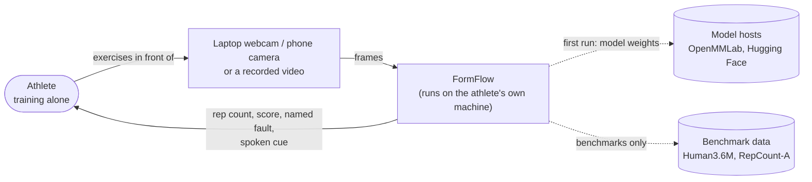
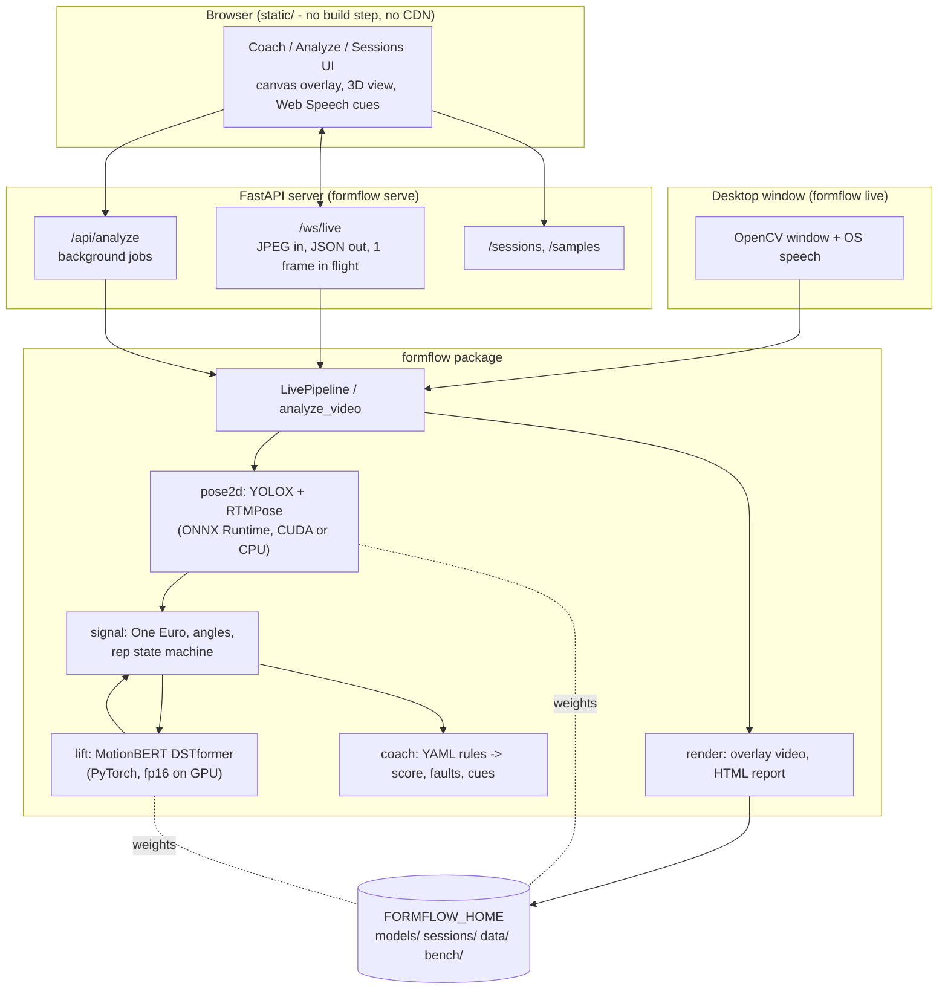
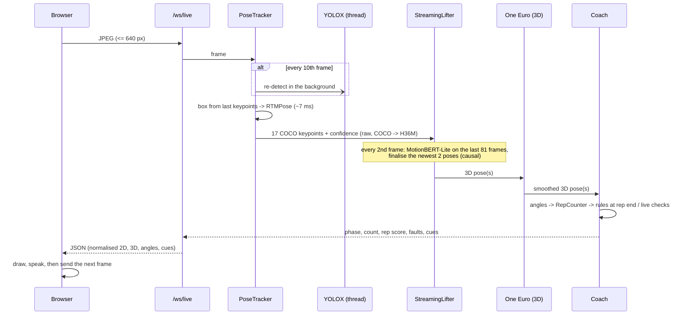
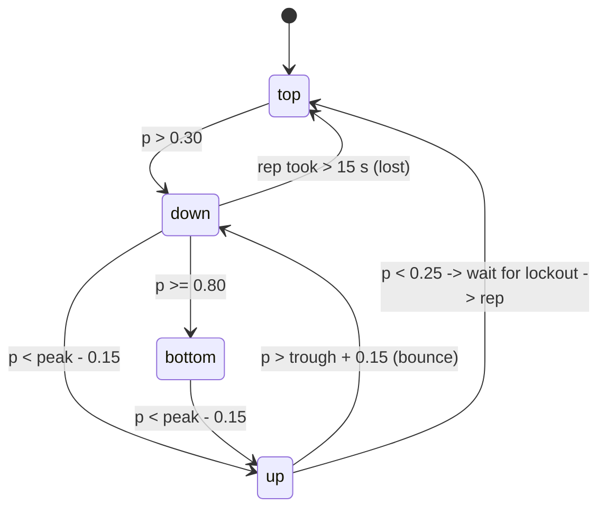

# FormFlow architecture

## 1. Context (C4 level 1)

Nothing leaves the machine: frames are processed locally, and the browser talks only to the local server.

## 2. Containers (C4 level 2)

## 3. One live frame

## 4. Rep state machine

`p` is the movement signal normalised by the 5th/95th percentiles of the last 8 s, with the exercise's
nominal range as the prior until enough motion has been seen; peaks are kept as raw values and
re-normalised every sample. A rep counts if its peak reached `p >= 0.55` (shallower = "partial").
The rep ends at the lockout (where the signal stops returning), not at the threshold crossing, so tempo
and lockout rules see the real end of the rep.

## 5. Design decisions (with the measurement behind each)

| Decision | Why |
|---|---|
| MotionBERT ported, not vendored | Inference-only DSTformer with fused SDPA attention; checkpoints load `strict=True`; equals the original to 4e-6 (`tests/test_lift_pose.py`). Apache-2.0 (VideoPose3D weights are non-commercial). |
| "crop" 2D normalisation in the app | H36M's image normalisation is ~1.2 deg better at H36M's fixed framing but degrades to 11.9 deg of angle error when the athlete is half the size in the frame; crop stays at 5.7 deg. |
| MotionBERT-Lite everywhere | As accurate as the full model on H36M (8.2 vs 8.4 deg offline, 9.6 vs 9.7 deg live) at half the cost. |
| Causal 81-frame window, stride 2, fp16 | Live must not wait for future frames; 27 frames costs 0.5 deg, 243 frames triples the GPU time. |
| Live: lift raw 2D, One Euro on the 3D | Filtering the 2D input costs accuracy (lag: +0.3 deg) and barely reduces jitter; filtering the lifted skeleton removes 75% of the jitter for +0.2 deg. The 2D filter only smooths the drawn overlay. Offline uses no filter (the lifter sees future frames). |
| `view: front` rules skipped when side-on | Left/right symmetry and frontal-plane knee rules cannot be judged when one side of the body hides the other; a per-frame `side_view` metric gates them. |
| Rep counter armed only at the start position | A video that begins mid-rep produced a phantom rep; arming fixed it (+3 points OBO on RepCount). |
| Async re-detection | YOLOX-m costs ~60 ms on a laptop RTX 3050; RTMPose on a keypoint-derived box costs ~7 ms. Detection runs every 10th frame on a thread and never stalls the frame loop. |
| KASR at the squat bottom instead of the knee projection angle | The frontal-plane projection angle explodes in deep flexion (the projected thigh is short): 40 deg for a mild cave-in. KASR is stable; wide stances read < 1 while standing, so it is checked at the bottom only. |
| Hip flexion via the pelvis -> thorax line | The side-hip -> thorax line adds a constant ~15 deg (the hip joints are lateral to the spine). |
| Rules in YAML | Adding an exercise = adding a file; the engine knows limit / tempo / ratio rules and min, max, percentile, start / end / bottom, range and "rise above the starting posture" aggregates. |
| onnxruntime-gpu < 1.26 | 1.26+ is built for CUDA 13; 1.25 reuses the CUDA 12 libraries the PyTorch cu126 wheel already ships, so no CUDA toolkit is needed. |

## 6. Code map

| Path | What |
|---|---|
| `src/formflow/pose2d/` | ONNX Runtime sessions, YOLOX, RTMPose + SimCC decoding, tracker with async re-detection |
| `src/formflow/lift/` | DSTformer port, `Lifter` (normalisation, flip TTA, overlapping offline clips), `StreamingLifter` |
| `src/formflow/signal/` | One Euro filter, joint metrics, gravity estimate, rep state machine, periodicity |
| `src/formflow/coach/` | exercise definitions (YAML), rule engine, live checks |
| `src/formflow/pipeline.py` | `Coach` (everything after 2D) and `LivePipeline` |
| `src/formflow/analyze.py` | whole-video analysis, annotated MP4 (H.264 via imageio-ffmpeg), tracks |
| `src/formflow/render/` | OpenCV overlay / 3D view / signal strip, HTML report |
| `src/formflow/server/` | FastAPI app + static single-page UI |
| `src/formflow/desktop.py` | `formflow live` OpenCV window |
| `src/formflow/bench/` | H36M joint-angle evaluation, RepCount evaluation, speed, report |
| `src/formflow/synth.py` | synthetic athlete (tests, demo) |
| `configs/` | runtime settings and one YAML per exercise |
